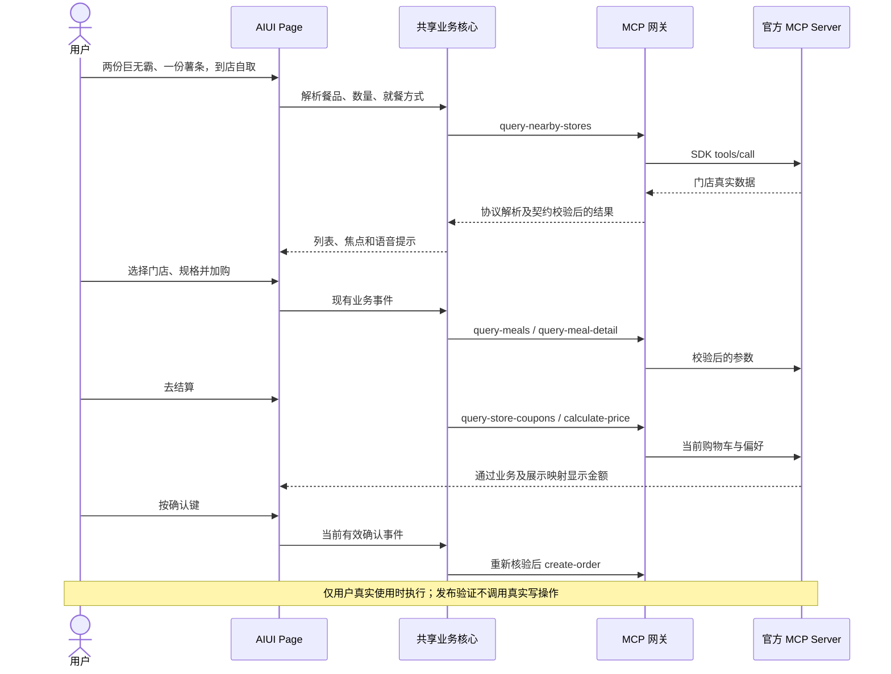

# 麦当劳 MCP 实际接入说明

## Server 与授权

真实模式连接官方 **`https://mcp.mcd.cn`**，采用 **Streamable HTTP**，使用官方 `@modelcontextprotocol/sdk` 客户端。请求头为 `Authorization: Bearer ${MCD_MCP_TOKEN}`；本文件和配置示例仅展示环境变量占位符。

使用者自行在 https://open.mcd.cn/mcp 申请授权。本仓库不提供任何真实账号Token。本地configure命令将环境变量写入被Git忽略的设备配置；个人构建AIX含连接凭证，不得公开分发。Node兼容入口从环境获取自己的Token，并单独要求HTTP访问密钥。

## 实际工具范围

下表来自业务网关白名单和构建器，受当前平台工具目录及契约校验约束；不是将契约快照中的全部平台工具都实现。

| Tool | 作用 | 类型与流程 |
| --- | --- | --- |
| `now-time-info` | 平台时间信息 | 只读，预约及时间上下文 |
| `list-nutrition-foods` | 餐品营养信息 | 只读查询 |
| `query-nearby-stores` | 附近自取门店 | 只读，自取定位/位置输入后调用 |
| `delivery-query-addresses` | 已保存配送地址 | 只读，配送入口 |
| `delivery-create-address` | 新增配送地址 | 写操作，地址核对后按确认键 |
| `delivery-query-stores` | 地址对应配送门店 | 只读，选择地址之后 |
| `query-meals` | 门店真实菜单 | 只读，门店和时间上下文 |
| `query-meal-detail` | 真实规格及选项 | 只读，打开餐品后 |
| `query-store-coupons` | 门店可用券候选 | 只读，结算时与购物车适用商品编码匹配 |
| `calculate-price` | 实时算价、行小计及取餐方式 | 只读，进入确认和提交前核验 |
| `create-order` | 创建订单 | 写操作，确认键、防重及待核实保护 |
| `cancel-order` | 取消订单 | 写操作，先查最新状态、选官方原因、再按键确认；能力不可用时不猜接口 |
| `query-order` | 单笔订单与结果核实 | 只读，刷新、历史详情及待核实恢复 |
| `order-list` | 历史订单列表 | 只读，语音序号选择后直达详情 |
| `campaign-calendar` | 活动信息 | 只读查询 |
| `available-coupons` | 可领取优惠券 | 只读，不能等同已领取券 |
| `auto-bind-coupons` | 领取/绑定优惠券 | 写操作，必须按确认键 |
| `query-my-coupons` | 用户优惠券 | 只读，列表支持语音选择详情 |
| `query-my-account` | 账户与积分信息 | 只读查询 |

共享白名单见 `shared/mcp-result.ts`，工具契约快照见 `docs/mcp-tool-contracts.json`。快照只用于验证，平台工具返回发生变化时可能需要更新，不保证所有账号都具备所有能力。未实现积分抽奖，不能因为契约快照包含该Tool就自动调用。

## 从用户需求到页面

1. **协议解析**：优先读取structuredContent，否则解析文本JSON或TOON；平台错误返回转为明确业务错误，不把错误正文当菜单。
2. **契约校验**：连接时读取实际tools/list，与本地入参及输出契约比对；每次调用校验参数和响应。契约不符时拒绝调用，不能靠猜测补字段。
3. **业务状态**：保存门店、模式、菜单需求队列、规格、购物车及确认状态；检查会话revision和提交防重，偏好或购物车变化会使旧报价失效。
4. **展示映射**：把真实结果映射为当前页面需要的数据。完整菜单保留业务核心，Page仅收到当前批最多5项；换批、筛选、删除和撤销在本地完成，不产生额外MCP请求。
5. **提交核实**：业务写操作先记录待核实状态，响应不明时保留记录，优先用官方订单查询核实，不自动再提交。只有明确结果才显示成功。

## 数据与金额原则

- 产品、门店、券编码来自MCP，不通过模型生成。
- 商品价格显示本次数量对应的 `calculate-price.productList.subtotal`，无法唯一关联时显示“价格待核实”，不平摊应付金额。
- 门店距离展示MCP返回值；高德仅可辅助地址解析，不计算距离，不将导航距离冒充其他距离。
- “打包”默认值必须匹配真实 `takeWayList` 中的中文选项及其编码；不能识别时阻止提交，不猜堂食编码。
- 券只按可可靠关联的适用商品编码匹配，无匹配时跳过选择；最终以实时算价为准，不强行推荐。
- 真实网络等待与本地展示耗时分别记录；本地只显示5项不代表上游接口只返回5项。

## 业务价值与验证范围

MCP使眼镜能够基于用户自己的真实门店、菜单、优惠及订单完成查询和准备操作，而非展示固定假菜单。语音减少逐层输入，视觉核对与确认键保留用户控制。

发布验证使用隔离Mock覆盖全部写操作。既有真机图片与反馈仅证明相应时刻的部分场景，不证明本次公开版真实下单、支付或取消已通过。详细边界见 [验证记录](docs/VERIFICATION.md)。

官方资料：[MCP平台](https://open.mcd.cn/mcp) · [官方使用指南](https://github.com/M-China/mcd-mcp-server)。
