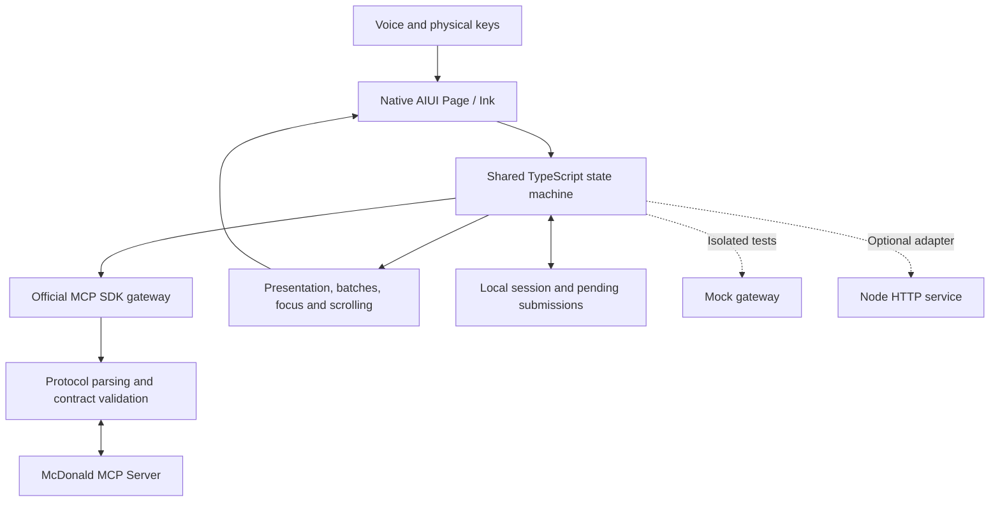

[简体中文](README.md) · [English](README.en.md)

<h1 align="center">Mcdonalds_in_RokidGlasses</h1>
<p align="center"><strong>McDonald’s × Rokid Glasses Ordering Assistant</strong></p>
<p align="center">Describe your meal, find a restaurant, review options and prices — keep the final submission under your physical control.</p>

A voice and key driven ordering application for **Rokid glasses users** and **McDonald’s MCP developers**. Its native AIUI Page uses a **480 × 352** canvas. In live mode, the glasses connect directly to McDonald’s MCP; an always-on computer is unnecessary. **Payment is completed on the phone through McDonald’s.**

This is an independently developed contest project, **not an official McDonald’s or Rokid product**. Availability, prices, coupons and restaurant capabilities depend on live official responses. Original code is [MIT licensed](LICENSE); brands and other assets retain their owners’ rights.

[UI gallery](#ui-gallery) · [Quick start](#quick-start) · [Voice examples](#voice-examples) · [Architecture](#architecture) · [MCP integration (Chinese)](MCP_INTEGRATION.md) · [Verification](docs/VERIFICATION.md) · [Design](docs/DESIGN.en.md)

## Why glasses?

When taking out a phone is inconvenient, say what you want and review the details in front of you. The application handles queries and navigation while you retain control of the restaurant, options, quantity, amount and final submission.

- **Multiple items in one sentence.** “两份巨无霸、一份薯条，到店自取” retains each item, its quantity and pickup preference separately. It does not search for the entire sentence as a product name.
- **Check the real menu first.** After you choose a restaurant, an unambiguous match can open its actual detail page. Ambiguous requests stay in a selection list; restaurants and cart additions are not chosen automatically.
- **Lists suited to glasses.** Menu batches contain up to five items, numbered from `(1)` in each batch. Batch changes and menu matching run locally.
- **A reversible cart.** Edit quantities, remove a complete line, clear the cart, or undo the most recent removal. Undo is held in memory and expires when leaving the supported flow or performing other invalidating actions.
- **Prices from calculation responses.** Item subtotals come from `productList.subtotal`, not menu reference prices or an allocation of the total. Unreliable associations display a verification message. Unmatched coupons are not recommended.
- **Physical confirmation protects submissions.** Voice can prepare address creation, coupon binding, order creation and cancellation; the final write requires the physical confirmation key on its confirmation page. Uncertain outcomes are reconciled before new submissions.

## UI gallery

**Device captures, isolated Ink / Mock runs and Figma designs are different evidence.** The device images below are historical captures of the personal application, not proof that this public edition has passed a complete live transaction. Sensitive order data is redacted. Mock prices and products are fictional test samples.

<table>
<tr><td align="center"><br>Device · original app 1.5.46</td><td align="center"><br>Isolated Ink / Mock · numbered menu</td></tr>
<tr><td align="center"><br>Isolated Ink / Mock · 1.5.52 · fulfillment</td><td align="center"><br>Isolated Ink / Mock · 1.5.52 · restaurant list</td></tr>
<tr><td align="center"><br>Isolated Ink / Mock · 1.5.52 · meal detail</td><td align="center"><br>Isolated Ink / Mock · selected options</td></tr>
<tr><td align="center"><br>Isolated Ink / Mock · cart</td><td align="center"><br>Isolated Ink / Mock · clear and undo</td></tr>
<tr><td align="center"><br>Isolated Ink / Mock · 1.5.52 · price review sample</td><td align="center"><br>Device · original app 1.5.52 · redacted</td></tr>
</table>

The [editable Figma design and flow overview](docs/DESIGN.en.md) align with the current implementation. Screen labels remain Chinese to match the device UI; this English documentation does not imply an English speech-recognition mode. See the [demo guide (Chinese)](docs/DEMO.md) for the review route.

## Quick start

### 1. Check the source without a live token

Use **Node.js >=22.13** and npm.

```bash
git clone https://github.com/JellyFlow/Mcdonalds_in_RokidGlasses.git
cd Mcdonalds_in_RokidGlasses
npm ci
npm run build:device
npm test
npm run typecheck
npm run check:docs
npm run check:public
```

These isolated tests do not require glasses or a live business account and do not perform live business writes.

### 2. Configure and run isolated Ink / Mock

Install an available `aix` CLI. The project has been exercised with CLI 0.10.1 and Ink preview 0.18.0; historical device checks used Ink 0.20.0. The automation expects macOS Chrome and Python Pillow. Other platforms require adapting the browser path.

```bash
npm ci
npm run configure:mock
npm run build:device
npm test
npm run verify:ink
```

`configure:mock` generates ignored local files: `aiui/lib/credentials.js`, `aiui/agent.json` and `local/app-identity.json`. It overwrites the local connection configuration and preserves an existing application identity.

**A Mock token does not switch the gateway.** Only `verify:ink` injects the Mock gateway and simulated transcripts into a temporary Page. Ordinary `preview`, packaging and device installation do not create an isolated Mock application. Simulated transcripts do not verify a real microphone or wake word.

Change base Mock responses in `server/src/mock.ts`; change Ink-specific data overrides, transcripts and assertions in `scripts/verify-ink-controls.mjs`. Screenshots are generated under ignored `artifacts/verification/`. The tracked report is `docs/key-voice-verification.json`; inspect it before committing. More details are in the [development guide (Chinese)](docs/DEVELOPMENT.md#隔离-mock-配置步骤).

### 3. Build privately with your own account

Obtain your own token from the [McDonald’s MCP platform](https://open.mcd.cn/mcp). Set `MCD_MCP_TOKEN` locally, either in your shell or in ignored `.env.local`. `AMAP_WEB_KEY` is optional for address resolution; restaurant distances always come from McDonald’s MCP.

```bash
# Set your own MCD_MCP_TOKEN first; do not commit it.
npm run configure
npm run build:device
npm run pack
# Requires your authorized ADB device.
npm run install:device
```

Local configuration generates a separate application identity. Preserve `local/app-identity.json` for upgrades. Generated credentials and personal AIX packages must remain private; this repository does not distribute the author’s personal installation package. A live AIX embeds its connection credentials. Do not upload it or treat it as a general-purpose installer. See the [installation guide (Chinese)](docs/DEVELOPMENT.md).

For the optional local Node Mock service, generate an `APP_ACCESS_KEY` of at least 20 characters, then run `npm run demo`. It is separate from the glasses’ direct MCP gateway and listens on localhost by default. `APP_ACCESS_KEY` is not the MCP token.

## Voice examples

On the home page, say **“乐奇”** to wake recognition. Supported pages listen once on entry, for up to 15 seconds plus a maximum 3-second final-result wait. Recognition does not restart indefinitely. Wake it again after the attempt ends.

| Page | Chinese phrase | Meaning and boundary |
| --- | --- | --- |
| Home | 两份巨无霸、一份薯条，到店自取 | Two Big Macs and one fries for pickup; validate after choosing a restaurant, do not auto-add |
| Home | 打开购物车 / 查看购物车 / 我的购物车 | Open the current session cart; pending reconciliation takes priority |
| Lists | 选第一家 / 选第一单 / 选第三张券 | Select a restaurant, historical order or coupon only when the target is unambiguous |
| Menu | 选第一份 / 换一批 / 全部餐品 | Select within the current batch, change batch, or clear local filtering |
| Options | 生菜和烤味酱 | Select both only where the actual option constraints allow it |
| Cart | 删除第一项 / 删除中份薯条 | Remove the full line; duplicate names require an ordinal |
| Cart | 清空购物车 / 删除所有商品 / 撤销删除 | Clear all items or restore the latest removal; undo expires outside its supported flow |
| Review | 需要餐具 / 堂食 / 修改订单 | Change supported preferences; invalidate the previous quote confirmation |
| Review | 确认下单 | Prompt for the physical confirmation key; do not submit by voice |

Arrow keys move focus; the confirmation key activates a control. Enter ends an active recording and Back cancels it. Spoken “返回” follows business navigation. Physical double-back desktop exit is host dependent and has **not received an unambiguous independent device acceptance result**.

## Architecture



The UI uses native `.ink` and WXSS rather than React or touch input. The shared core runs locally on the glasses and in the optional Node adapter. The gateway uses Streamable HTTP, parses JSON/TOON, and validates arguments, results and runtime tool contracts. Local rendering optimizations do not imply faster upstream network responses.

The actual server is `https://mcp.mcd.cn`, authenticated using `Authorization: Bearer ${MCD_MCP_TOKEN}`. The [integration document (Chinese)](MCP_INTEGRATION.md) lists the actual tools, call sequence and read/write boundaries. The [configuration example](mcp-config.example.json) contains environment placeholders only.

## Verification and limitations

The source baseline is 1.5.52. The public edition passed 189 business/Page tests plus 3 configuration tests, type checks, clean-checkout builds and 166 isolated Ink checks; the [verification record (Chinese)](docs/VERIFICATION.md) defines their scope.

- Historical device captures and wearer feedback cover parts of queries, voice selection and cart operations; they are not a complete public-edition live transaction acceptance.
- Intercepting `window.close()` in a browser does not prove physical desktop exit on glasses.
- No live coupon binding, address creation, ordering, cancellation or payment was performed for this documentation update. Writes in automation use Mock state.
- Actual availability depends on the restaurant, account, network and runtime contracts. Unknown or inconsistent submissions are reconciled rather than retried automatically.

## Requirements, design and contest

- [Product requirements (Chinese)](docs/PRODUCT.md), [design notes (English)](docs/DESIGN.en.md), [design notes (Chinese)](docs/DESIGN.md).
- [Provenance and baseline history (Chinese)](docs/PROVENANCE.md); the public source is independently understandable without access to the private source repositories.
- [Official contest declaration](CONTEST_DECLARATION.md), copied unchanged, and [contest status (Chinese)](docs/CONTEST.md). Creating an application Issue alone does not prove successful registration; the official response is authoritative.

## Contributing and license

Report the device/runtime version, reproduction steps and redacted screenshots through Issues. Do not submit tokens, personal orders or addresses. Read [contributing guidelines (Chinese)](CONTRIBUTING.md), run the checks and preserve physical confirmation protection.

Original code is [MIT licensed](LICENSE). Brands, food images, fonts and third-party icons retain their respective rights; see [third-party notices (Chinese)](THIRD_PARTY_NOTICES.md). This documentation does not grant trademark or asset rights.
