<h1 align="center">Mcdonalds_in_RokidGlasses</h1>
<p align="center"><strong>麦当劳 × Rokid 眼镜点餐助手</strong></p>
<p align="center">
  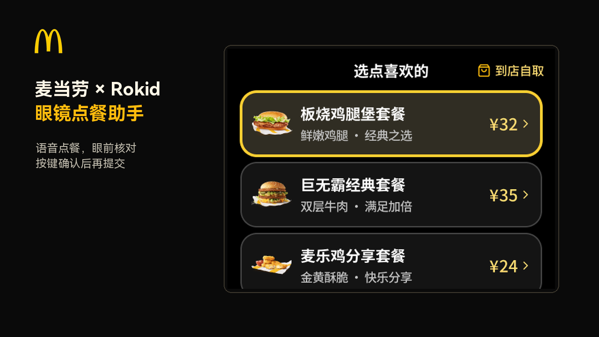
</p>
<p align="center">一句话说出想吃的，眼镜帮你找店、选餐、核价；真正提交，仍由你按键确认。</p>
<p align="center">
  <a href="LICENSE"></a>
  
  
  <a href="MCP_INTEGRATION.md"></a>
</p>

面向 **Rokid 眼镜使用者**及 **麦当劳 MCP 应用开发者**的语音点餐项目。使用 AIUI 原生 Page，在 **480 × 352** 画布中结合语音与按键操作。真实模式下，眼镜直接连接麦当劳 MCP；电脑不必常开，支付仍在手机麦当劳端完成。

本项目为独立开发的参赛作品，**非麦当劳或 Rokid 官方产品**。餐品、库存、价格与优惠可用性以官方实时响应为准。

**快速导航：** [界面演示](#界面演示) · [快速开始](#快速开始) · [语音示例](#语音示例) · [架构](#架构与技术栈) · [MCP 接入](MCP_INTEGRATION.md) · [验证与限制](docs/VERIFICATION.md) · [参赛声明](CONTEST_DECLARATION.md)

## 为什么把点餐放到眼镜上

当你不方便拿出手机时，先把“想吃什么”说清楚，再用眼前的小屏核对细节。眼镜承担查询和选择，用户保留对门店、规格、数量、金额和最终提交的控制。

- **一句话，多个需求。** “两份巨无霸、一份薯条，到店自取”，分别保留餐品、数量和就餐方式，不把整句话当作搜索词。
- **先核实，再选餐。** 选择真实门店后，根据其 MCP 菜单匹配；唯一明确餐名可打开详情，模糊或同名结果交给用户选择，不自动加购。
- **为眼镜收紧列表。** 每批最多5项，编号从 `(1)` 开始，支持本地换批和按序号选择，减少页面数据与渲染负担。
- **购物车可以反悔。** 支持修改数量、按序号或完整餐名删除整行、清空购物车、撤销最近一次删除。
- **金额来自真实算价。** 商品小计使用算价返回值；无法可靠对应时显示“价格待核实”。没有可匹配优惠券时跳过选择页。
- **提交留给确认键。** 语音可以准备流程，新增地址、领券、创建及取消订单仍需在对应确认页按键提交；结果不明时先核实，不自动重试。

## 界面演示

### 真机演示视频

<p align="center">
  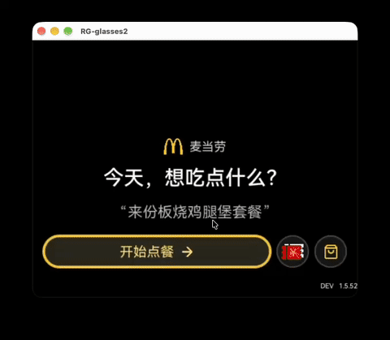
</p>

GIF 来自本地真机演示窗口，约 19 秒；展示语音点餐、餐品规格、购物车和支付前确认流程，不代表完整真实交易验收。

下列图片包含个人工程的既有真机记录，以及本次基于1.5.52源码重跑的隔离 Ink / Mock 场景。**真机、Mock 与 Figma 设计稿分开标注**，不是在线演示或公开版全流程真机验收。订单图已遮盖订单号、取餐号及门店信息。

<table>
<tr><td align="center">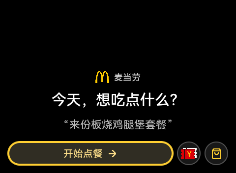<br>真机首页 · 原应用1.5.46</td><td align="center">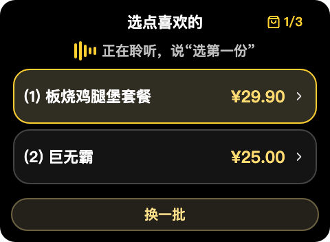<br>隔离 Ink / Mock · 语音选餐与批次</td></tr>
<tr><td align="center">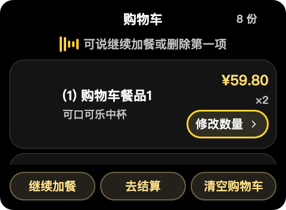<br>隔离 Ink / Mock · 购物车操作</td><td align="center">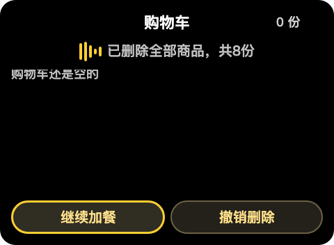<br>隔离 Ink / Mock · 清空后撤销</td></tr>
<tr><td align="center">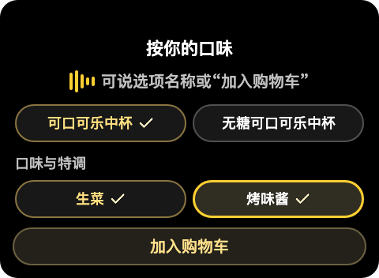<br>隔离 Ink / Mock · 规格多选</td><td align="center">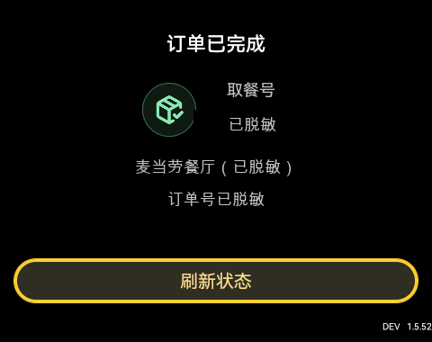<br>真机订单状态 · 原应用1.5.52，已脱敏</td></tr>
<tr><td align="center">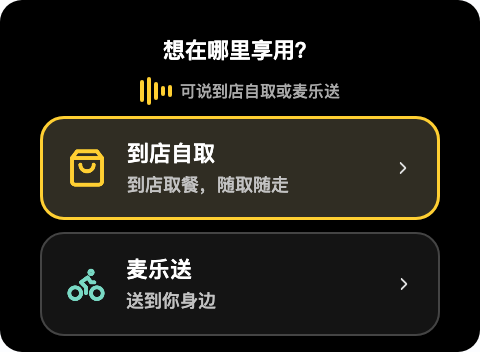<br>隔离 Ink / Mock · 1.5.52 · 就餐方式</td><td align="center">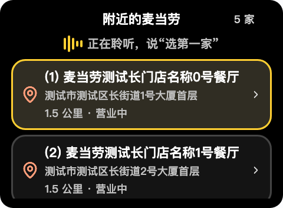<br>隔离 Ink / Mock · 1.5.52 · 门店地址与编号</td></tr>
<tr><td align="center">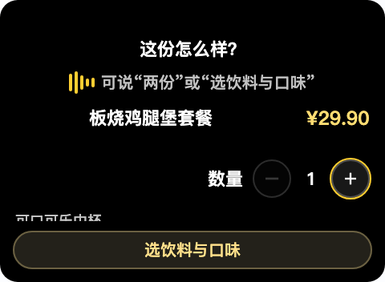<br>隔离 Ink / Mock · 1.5.52 · 餐品详情</td><td align="center">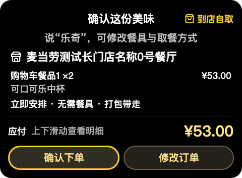<br>隔离 Ink / Mock · 1.5.52 · 算价确认样本</td></tr>
</table>

可编辑设计稿及流程总览见[真机同步设计说明](docs/DESIGN.md)。画面内文案保留中文；英文项目说明见[English README](README.en.md)。

完整操作路线见[演示指南](docs/DEMO.md)。Mock 中的餐品、价格和状态是隔离样本，不能据此判断真实可售性或报价。

## 项目文件结构

```text
aiui/       Native AIUI Page、页面资源与界面逻辑
device/     设备运行入口、网关和本地存储
shared/     业务类型、菜单、订单和视图状态
server/     MCP 适配与隔离 Mock 服务
scripts/    配置、构建、打包和 Ink 验证脚本
docs/       PRD、设计说明、验证记录和公开演示素材
```

`local/`、`artifacts/` 和 `node_modules/` 是本地配置或构建目录，不属于公开运行必需文件。

## 快速开始

### 1. 检出并验证源码，无需真实 Token

需要 **Node.js 22.13 或以上版本**及 npm。

```bash
git clone https://github.com/JellyFlow/Mcdonalds_in_RokidGlasses.git
cd Mcdonalds_in_RokidGlasses
npm ci
npm run build:device
npm test
npm run typecheck
npm run check:docs
npm run check:public
```

这条路线使用隔离 Mock 测试，不需要眼镜、不连接真实业务账号，也不执行真实业务写操作。

### 2. 配置并运行隔离 Mock

另外安装可用的 `aix` CLI。项目曾在 CLI 0.10.1、Ink预览0.18.0及真机Ink0.20.0环境验证；宿主版本差异可能影响按键和语音。

```bash
# 在项目根目录执行，无需真实 MCP Token
npm ci
npm run configure:mock
npm run build:device
npm test
npm run verify:ink
```

此命令运行实际 Ink Page，使用原生键事件、Mock 网关及模拟识别文本；**不代表真实麦克风通过**。自动化脚本默认使用 macOS 的 Chrome 路径，需要该浏览器；其他系统需调整脚本中的 Chrome 启动路径。

`configure:mock` 自动生成被 Git 忽略的 `aiui/lib/credentials.js`、`aiui/agent.json` 和 `local/app-identity.json`，无需手动填写凭证。它会覆盖本地连接配置，但保留已有应用身份。

**Mock Token 不会自动切换业务网关。** 只有上述 `verify:ink` 路线会在临时 Page 中注入 Mock 网关和模拟识别文本；普通 `preview` 以及直接打包、安装均不能当作隔离 Mock。修改模拟数据的位置及恢复真实配置的方法见[开发文档的 Mock 步骤](docs/DEVELOPMENT.md#隔离-mock-配置步骤)。

### 3. 使用自己的账号构建眼镜应用

先在[麦当劳 MCP 平台](https://open.mcd.cn/mcp)申请自己的 Token，再按[本地配置与安装指南](docs/DEVELOPMENT.md)配置环境变量、生成本地凭证和独立应用身份，执行打包及安装。

```bash
# 先在当前终端设置自己的 MCD_MCP_TOKEN，再执行：
npm run configure
npm run pack
npm run install:device
# 单设备且已完成 ADB 授权；多设备须显式传入序列号
```

**本仓库不分发个人版 AIX 或含凭证源码压缩包。** 本地生成的 AIX 会包含你的设备端连接凭证，只能由你私下使用，不能上传或当作通用安装包分发。首次本地配置会生成独立应用身份，不复用作者个人版身份；后续升级复用自己的 `local/app-identity.json`，不提供清数据操作。

高德 Web Key 是可选的地址解析辅助配置，未配置时使用现有位置输入恢复入口；门店距离始终展示麦当劳 MCP 返回值，不使用高德计算距离。

## 语音示例

首页先说“乐奇”唤醒；支持自动监听的页面进入后监听一次，最长15秒，再等待最终结果最多3秒，不无限重录。结束后可再次唤醒。

| 位置 | 可以说什么 | 行为边界 |
| --- | --- | --- |
| 首页 | 两份巨无霸、一份薯条，到店自取 | 保留需求，选店后核实；不自动选店或加购 |
| 首页 | 打开购物车 / 查看购物车 / 我的购物车 | 打开当前会话购物车，待核实提交优先 |
| 门店、订单、优惠券列表 | 选第一家 / 选第一单 / 选第三张券 | 只接受明确可选目标，同名提示按序号 |
| 菜单 | 选第一份 / 换一批 / 全部餐品 | 序号仅对应当前批次；换批不重复请求 MCP |
| 规格页 | 生菜和烤味酱 | 依照真实规格限制多选并勾选，不虚构选项 |
| 购物车 | 删除第一项 / 删除中份薯条 | 删除该行全部数量，同名不猜测 |
| 购物车 | 清空购物车 / 删除所有商品 / 撤销删除 | 可恢复最近删除的完整行或整车；离开流程等操作使撤销失效 |
| 确认页 | 需要餐具 / 堂食 / 修改订单 | 使用真实可用选项，偏好改变使旧报价确认失效 |
| 确认页 | 确认下单 | 仅提示按确认键，不直接提交 |

方向键移动焦点，确认键激活；录音时 Enter 结束、返回取消。语音“返回”走上一级。订单状态页的物理双击退出属于宿主相关能力，独立真机验收仍待明确确认，详见[验证与限制](docs/VERIFICATION.md)。

## 架构与技术栈

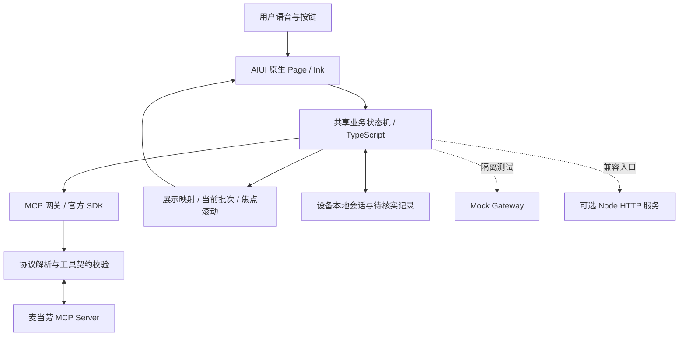

- **UI：** 原生 AIUI `.ink`、WXSS；不依赖 React 页面，也不要求触屏。
- **业务：** TypeScript共享核心，支持设备本地运行及Node兼容服务。
- **MCP：** 官方 SDK + Streamable HTTP；解析JSON/TOON，校验入参、响应及运行时工具契约。
- **状态：** 设备本地存储会话；删除撤销快照仅内存保存，不持久化。
- **测试：** Node测试运行器、隔离Mock、类型检查及实际Ink键控验证。

详见[MCP调用流程与工具说明](MCP_INTEGRATION.md)及[工程目录与构建说明](docs/DEVELOPMENT.md)。精简显示只能降低本地渲染负担，**不等于缩短上游网络耗时**。

## 验证与限制

公开版基于原工程1.5.52；原工程已有189项业务与Page测试，本仓库新增公开配置测试。当前实际执行结果及版本范围见[验证记录](docs/VERIFICATION.md)。

- 已有真机证据和佩戴者反馈覆盖部分查询、语音选餐及购物车操作，不等于新账号从安装到下单的完整验收。
- 原工程“订单状态页双击到系统桌面”尚未取得明确独立验收，不能仅凭 `window.close()` 模拟调用判定通过。
- 实际菜单、价格、可用券及预约能力受门店、账号、网络和平台工具契约影响；变化时拒绝冒险提交。
- 本次公开整理不执行真实领券、地址新增、下单或取消，不处理支付，不声称完成全部交易链路。

## 需求、设计与参赛材料

- [产品需求与范围](docs/PRODUCT.md)：本仓库可独立阅读的需求摘要。
- [设计与交互说明](docs/DESIGN.md)：布局、编号、监听与确认规则，附设计样例。
- [来源与版本历史](docs/PROVENANCE.md)：工程、PRD及设计仓库关系与基线。
- [MCP 接入说明](MCP_INTEGRATION.md)、[脱敏配置示例](mcp-config.example.json)、[官方参赛声明](CONTEST_DECLARATION.md)。
- 本项目拟参与[麦当劳程序员创意开发大赛](https://github.com/M-China/mcd-developer-innovation-challenge)，报名结果以官方Issue系统回复为准，见[报名记录](docs/CONTEST.md)。

## 贡献与许可

欢迎通过Issue报告设备版本、复现步骤及脱敏画面；请勿提交Token、个人订单或地址。代码修改先阅读[贡献指南](CONTRIBUTING.md)，运行测试并保持确认保护。

自有代码采用[MIT许可](LICENSE)。品牌、食品图片、第三方图标等不随代码授予商标或素材使用权，详见[第三方声明](THIRD_PARTY_NOTICES.md)。
