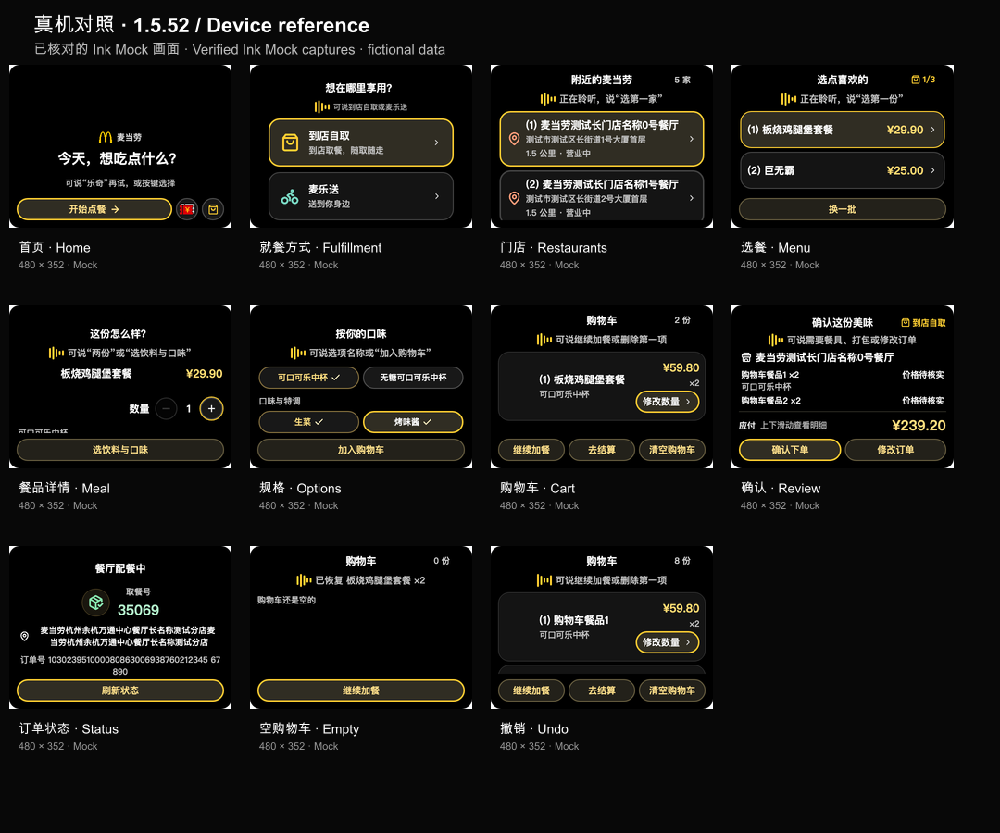

[简体中文](DESIGN.md) · [English](DESIGN.en.md)

# 设计与交互说明

## 可编辑 Figma 与版本

[打开 Figma：真机同步 · 1.5.52](https://www.figma.com/design/SdkRT16rRIyzNJpWggXW4I/?node-id=309-3333)。[核心流程演示入口](https://www.figma.com/proto/SdkRT16rRIyzNJpWggXW4I/?node-id=309-3334&starting-point-node-id=309%3A3334)。

可编辑页面基于当前1.5.52源码制作；另有「真机对照 · 1.5.52」（node-id=311-3799）页面，放置已核对的480×352 Ink Mock参考画面，作为精确视觉基准，避免Figma文字渲染差异造成误判。原有三个设计页面保留。可编辑页面包含独立文本、向量图标、卡片和按钮实例。

**下图为已核对的 Ink Mock 参考总览，不是真机证据。** 图内餐厅、订单号及价格组合为虚构演示样本；语音动作以注释描述，点击连线仅模拟页面跳转，不执行识别、支付或真实业务提交。

## 画布和层级

原生AIUI Page采用480×352业务画布。首页标题30/38px；普通标题和主要餐名22/30px；菜单价格24/32px；主要监听提示20/28px；次要信息18/26px；底部操作48px。就餐方式页沿用其实际较紧凑的监听提示样式，不强行套用其他页面字号。

以应用源码的布局和字体度量为依据，复用原文件的品牌素材、字体和颜色变量。新版按钮组件独立创建，保留普通、焦点两种状态，不修改历史稿的共享组件。Figma画面内保留中文，画面外提供中英文说明；这不表示应用支持英文语音。

标题与监听提示固定，列表独立滚动；餐名和金额各占独立列，金额不换行，长名称换行。每批菜单最多5项，当前批编号从 `(1)` 开始；菜单不恢复食品图标。门店卡片保留完整地址、距离与营业状态，未在当前视口显示的内容由真实应用滚动查看。

## 核心画面与运行证据

| Figma画面 | 对齐内容 | 对照图片 |
| --- | --- | --- |
| 首页 | 品牌、示例文案、原有三个底部入口；无麦克风按钮 | [既有真机首页，1.5.46](images/home-device.png) |
| 就餐方式 | 标题下提示，自取和配送两张卡片 | [本次1.5.52 Mock运行](images/fulfillment-mock.png) |
| 门店 | 编号、完整地址、独立滚动与监听提示 | [本次1.5.52 Mock运行](images/stores-mock.png) |
| 菜单 | 批次、编号、80px短卡片、独立价格列及换批 | [隔离Ink / Mock](images/menu-mock.png) |
| 餐品详情 | 数量、价格、口味入口及内嵌监听 | [本次1.5.52 Mock运行](images/meal-mock.png) |
| 规格 | 勾选与焦点分别表达；多选服从真实规格 | [隔离Ink / Mock](images/customize-mock.png) |
| 购物车及空状态 | 清空、最近一次撤销、空车不可结算 | [购物车](images/cart-mock.png)、[清空后撤销](images/undo-mock.png) |
| 确认订单 | 商品小计、同行偏好、应付金额和单条分隔线 | [本次1.5.52 Mock算价样本](images/review-mock.png) |
| 订单状态 | 取餐号、居中餐厅名与订单号，无详情分页 | [已脱敏真机记录，1.5.52](images/order-device-redacted.png) |

新增四张运行图片来自实际Ink中的隔离Mock场景，语音文本由脚本模拟。确认图使用单行商品的固定算价样本，商品小计与应付均为该Mock响应中的值，不代表真实门店报价。Figma使用另一组明确标注的虚构数据，不将设计金额冒充真实算价。

## 语音、按键与原型边界

支持自动监听的页面进入时监听一次，不挡住原内容。主要监听提示无背景，实际监听时显示动态音量条，结束后显示可重试提示；Figma仅绘制该动效的静态一帧。识别最多15秒，加最多3秒最终结果等待，不无限重录。

方向键移动焦点，确认键激活，录音期间返回先取消。规格勾选独立于焦点，选择后保留勾选并聚焦最后一项。购物车可删除整行、清空及撤销最近一次删除；空车隐藏结算与清空入口。确认页偏好变更使旧报价确认失效，最终业务提交必须按确认键。

Figma核心连线覆盖首页、就餐方式、门店、菜单、详情、规格、购物车、确认页和状态页，另有空购物车及清空后撤销分支。确认页进入订单状态的连线只是演示占位，跳过的真实支付及核实步骤不在此点击原型中执行；支付仍需在手机完成。未实现的配送分支以说明标注，不伪装成已完成流程。

Figma不增加画布返回按钮。真实物理返回桌面仍缺乏明确独立验收结论，不能以原型连线、模拟关闭或历史截图判定通过。

## 公开与验证范围

真机、Mock和设计稿分别标注版本与来源；不包含真实账号、地址、订单号或连接凭证。公开图片及文案遵守项目统一措辞规则。原型资料、品牌及素材权利见[第三方声明](../THIRD_PARTY_NOTICES.md)，验证范围见[验证记录](VERIFICATION.md)，来源见[资料来源](PROVENANCE.md)。
