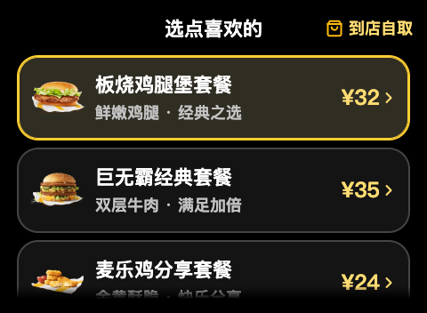

# 设计与交互说明

## 画布和层级

原生AIUI Page采用480×352业务画布。标题22/30px，主要餐名22/30px，监听提示20/28px，次要信息18/26px，底部操作48px。保留黄、黑品牌视觉与明确焦点，不增加触屏依赖。

标题与监听提示固定，列表独立滚动；餐名与金额各占独立列，长名称换行。列表使用统一测量结果控制高度和scroll-top，避免焦点跳到看不到的末项。每批菜单最多5项，当前批编号从(1)开始。

## 语音和按键

进入支持的列表或编辑页内嵌监听，不挡住原内容。只有实际录音时显示动态音量条，结束后保留可重试提示。方向键移动焦点，确认键激活，录音期间返回先取消。选中规格显示勾选，与焦点区分。

购物车默认三个底部按钮：继续加餐、去结算、清空购物车；有最近删除可撤销时，用撤销删除替换清空入口。空购物车保留继续加餐和撤销入口，不提供结算。

确认页显示真实商品小计、偏好、应付金额；状态页的真实餐厅名和订单号居中换行，无详情分页。敏感提交仍按确认键。

## 设计样例

下图为来自设计资料仓库的静态交互原型，包含虚构数据，**不是真机证据，也不代表当前全部页面完全一致**。

当前真实和Mock运行画面见[README](../README.md#界面演示)，来源与许可见[资料来源](PROVENANCE.md)和[第三方声明](../THIRD_PARTY_NOTICES.md)。
