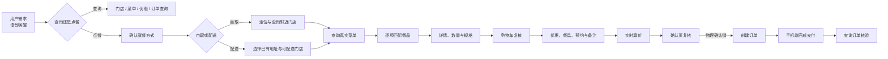

# 麦当劳 × Rokid 眼镜点餐助手：产品需求

## 产品定位

这是一个运行在 Rokid 眼镜 AIUI Page 上的语音优先点餐助手，面向拥有个人麦当劳 MCP 授权的体验用户。用户可以在不拿出手机的情况下，说出想吃的餐品、数量和就餐方式，再通过眼镜查看门店、菜单、规格、购物车和实时金额。

眼镜负责理解需求、展示必要信息、调用查询与算价能力，并引导用户完成确认；支付仍在手机端完成。当前公开版本是单账号本地体验，不能视为生产多用户系统。

## 核心原则

- **语音输入，视觉确认**：语音用于表达需求和修改选择，眼镜画面用于查看餐品、门店、金额和当前焦点。
- **真实数据优先**：产品编码、可售性、规格、优惠、取餐方式和价格均以 MCP 实时响应为准，不用模型猜测或菜单参考价替代。
- **副作用必须确认**：创建订单、取消订单、新增地址和其他业务写操作，必须由当前确认页的物理确认键触发；语音只能准备或修改。
- **凭证不进入界面**：MCP Token、账号标识、个人地址和订单数据不写入页面文案、公开资源或普通日志。
- **流程可恢复**：返回、取消、失败和结果不明确时保留可恢复上下文；结果不明确先核验，不重复提交。

## 当前支持能力

- 首页通过“乐奇”唤醒后，识别一句话中的多种餐品、数量和明确的到店自取/麦乐送意图；没有明确方式时保留餐品需求并询问。
- 自取查询附近门店，配送查询已有地址和可配送门店；不自动替用户选择门店。
- 查询真实菜单，按口述顺序逐项处理。唯一明确匹配可进入详情，歧义或模糊需求进入每批最多 5 项的选择列表。
- 餐品详情支持数量、套餐子项和规格选择；用户加入购物车后才推进下一项，也可以跳过当前需求。
- 购物车支持继续加餐、修改数量、删除单行、清空全部商品，以及撤销最近一次删除；撤销记录只在当前购物车流程内有效。
- 优惠券按当前购物车商品和真实商品编码匹配；没有可用券时跳过优惠券页面，不强行推荐。
- 默认偏好为无需餐具、立即安排和打包带走；已有明确预约时保留预约。确认页支持语音修改可用偏好。
- 通过实时算价响应展示商品小计、优惠、费用和应付金额。确认页只能通过物理确认键提交创建订单。
- 支持订单列表、订单详情和状态查询；明确已取消的状态页按当前返回规则处理，物理桌面退出能力单独记录验收。

## 主流程与异常恢复

- 无匹配餐品时显示真实原因，提供“全部餐品”和“重新说需求”等恢复入口，不自动展示无关餐品。
- 门店、菜单、规格或算价请求失败时保留当前上下文，允许重试或返回修改；不重复发起已失效的请求。
- 识别结果迟到、超时或无法确定时忽略结果并保留当前页面，不猜测目标、不自动选择默认项。
- 创建订单结果丢失或矛盾时先查询订单核验，确认未创建且允许重试后才重新进入提交。
- 取消订单必须先查询最新状态、选择服务端提供的取消原因，再到确认页由物理按键提交；取消结果还要通过订单查询核验。

## MCP 接入边界

| 阶段 | 关键 Tool | 数据用途 | 写操作边界 |
| --- | --- | --- | --- |
| 门店与地址 | `query-nearby-stores`、`delivery-query-addresses`、`delivery-query-stores` | 位置、地址和可用门店 | 新增地址需单独确认 |
| 菜单与详情 | `query-meals`、`query-meal-detail` | 商品、规格、套餐子项和可售性 | 不根据名称猜产品编码 |
| 优惠 | `query-store-coupons`、`query-my-coupons` | 当前商品可用优惠 | 不可用或无匹配时跳过 |
| 算价 | `calculate-price` | 商品小计、优惠、费用、取餐方式和应付金额 | 报价失败保留购物车 |
| 订单 | `create-order`、`query-order`、`order-list` | 创建后核验、订单状态和历史列表 | 创建只能由物理确认键触发 |
| 取消 | `cancel-order` | 取消原因和取消结果 | 必须确认并再次查询核验 |

MCP 返回的编码、金额和状态是唯一业务依据。应用只负责参数校验、状态管理、页面摘要和错误恢复，不把 Token 下发到页面或语音内容。Mock 网关只用于隔离测试和 Ink 画面验证，不代表真实授权、真实麦克风或真实交易通过。

## 交互与验收标准

- 页面使用 480×352 画布；标题、监听提示、列表和底部操作保持独立区域，长文本通过实际换行和滚动展示。
- 支持页面进入时一次自动监听；首页需要先说“乐奇”。单次录音最长 15 秒，结束后等待最终结果最多 3 秒，不循环无限拾音。
- 方向键移动焦点，确认键激活当前操作；按键选择、离页、隐藏、设置和取消时释放麦克风，并忽略迟到识别结果。
- 语音可以查询、选择、修改和准备操作，但不能绕过确认键创建订单、取消订单或执行其他敏感写操作。
- 商品价格使用算价响应中的商品小计；无法可靠对应时显示待核实，不平摊应付金额。
- Mock、真机和 Figma 设计稿分别标注来源。自动化通过不替代真实 MCP 授权、真实麦克风、支付或物理桌面验收。

## 范围与限制

- 不在眼镜内完成支付，支付交接和支付结果由手机或已验证宿主能力完成。
- 不持续后台监听，不自动领券、加购、下单、取消或新增地址。
- 不恢复 TTS，不把早期方案中的服务端代理、未验证 Worker 或未实现页面写成当前能力。
- 真实创建订单、取消订单和物理返回桌面的完整真机结果单独记录；不能用 Mock 结果替代。

## 参考资料

- [早期麦当劳 AIUI 需求文档](https://github.com/JellyFlow/McDonald_AIUI_Requirements)
- [当前源码与验证记录](../README.md)
- [MCP 工具接入说明](../MCP_INTEGRATION.md)
- [资料来源与版本记录](PROVENANCE.md)
